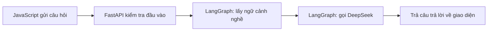

# La Bàn · Trang chủ hướng nghiệp KHKT 2027

## Trạng thái đồng bộ Task 4.4

Nhánh `main` đã được đồng bộ từ bản Task 4.4 có PostgreSQL/Neon,
Firebase, Guest 8 câu, thư viện 200 nghề, DeepSeek + DDGS và hành trình cùng tab.
Xem [báo cáo đồng bộ](docs/task44-main-integration.md),
[QA Task 4.4](docs/task44-final-qa.md) và
[điều tra ValidationError](docs/task44-validation-investigation.md).

`git.deploymentEnabled.main=false` chặn Vercel tự deploy khi push `main`, theo
phê duyệt của chủ dự án. Đồng bộ GitHub không phải phát hành Production.
Không tự bật lại cờ này hoặc chạy migration trên database đang hoạt động.
**Historical ValidationError – root cause undetermined. Task 4 tổng thể chưa hoàn thành.**

Các mô tả ban đầu phía dưới được giữ để tham khảo lịch sử. Với vận hành hiện tại,
ưu tiên các báo cáo và tài liệu triển khai mới được liên kết ở trên.

Trang chủ tiếng Việt dành cho học sinh THCS/THPT, dùng Python FastAPI, HTML, Bootstrap 5.3.8, CSS, JavaScript. AI dùng DeepSeek API và LangGraph.

## Chức năng đã có

- Giới thiệu dự án, đội thực hiện và mục tiêu hướng nghiệp trực quan.
- Sáu nghề mẫu; tìm kiếm không phân biệt dấu tiếng Việt, lọc lĩnh vực, xem hoạt động hàng ngày và kỹ năng trong hộp thoại.
- Ba bài viết với nội dung đầy đủ, đọc ngay trên trang.
- Truyện tranh **Một ngày làm việc** tại `/mot-ngay-lam-viec`: sáu nghề, 24 cảnh SVG có chuyển động, phát/dừng, đọc cả trang, tình huống tương tác, tổng kết kỹ năng và hỏi DeepSeek về cảnh đang xem. Xem [hướng dẫn truyện nghề](docs/career-stories.md).
- Tư vấn 1:1 sau đăng nhập tại `/ai-career-advisor`: DeepSeek qua LangGraph, lịch sử riêng, hồ sơ tự chia sẻ, Markdown an toàn; micro nhận diện tiếng Việt bằng Google Speech khi đã cấu hình hoặc Web Speech của trình duyệt.
- Responsive, menu điện thoại, điều hướng bàn phím, giảm chuyển động theo cài đặt thiết bị, trạng thái tải/lỗi và thử lại.
- Firebase Authentication: đăng ký/đăng nhập email, Google, quên mật khẩu, xác minh email, xem tài khoản và đăng xuất; cần cấu hình project để sử dụng thật.

Hiện có trang chủ, Firebase, tư vấn 1:1 và truyện tranh nghề nghiệp có chuyển động; chưa có lưu nghề yêu thích, lịch sử trắc nghiệm, quản trị hoặc video có lồng tiếng. Nghề nổi bật là nội dung bản mẫu, không phải xếp hạng thị trường.

Đọc [hướng dẫn tư vấn AI](docs/ai-advisor.md) để thử chat, micro và cấu hình DeepSeek, Google Speech. Thiếu khóa AI có thể bật `AI_DEMO_MODE=true`; câu trả lời mẫu luôn có nhãn.

## Thiết lập đăng nhập Firebase

Đọc [hướng dẫn Firebase từng bước](docs/firebase-setup.md). Đăng ký ứng dụng Web trong Firebase, bật Email/Password và Google, thêm domain chạy thử, rồi điền các biến `FIREBASE_*` vào `.env` hoặc Vercel. Mã đăng nhập không cần service account/private key. Khi chưa cấu hình, hộp đăng nhập thông báo đang được thiết lập và trang chủ vẫn hoạt động.

## Chạy trên Windows PowerShell

```powershell
python -m venv .venv
.\.venv\Scripts\python.exe -m pip install -r requirements.txt
if (!(Test-Path .env)) { Copy-Item .env.example .env }
# Điền DEEPSEEK_API_KEY vào .env trên máy của bạn.
.\.venv\Scripts\python.exe -m uvicorn app:app --reload
```

Mở http://127.0.0.1:8000. Trang chủ hoạt động khi chưa có API key; trợ lý sẽ báo đang được chuẩn bị. Không đưa key vào JavaScript, GitHub hoặc tài liệu.

```powershell
.\.venv\Scripts\python.exe -m unittest discover -s tests -v
```

## GitHub và Vercel

Đọc [hướng dẫn Vercel hiện tại](docs/vercel-deploy.md) trước khi triển khai: cấu hình FastAPI đã có, nhưng chat dùng SQLite/RAM nên cần storage bền vững và adapter phù hợp trước khi mở toàn bộ tính năng công khai. Các bước ngắn bên dưới chỉ mô tả import project, không xác nhận chat đã sẵn sàng production.

Repository đích do người dùng cung cấp: https://github.com/TrooliGM/quocan4.

1. Đăng nhập Vercel và chọn **Add New → Project**, import repository trên.
2. Chọn framework **FastAPI**, root directory là thư mục gốc repository; không cần lệnh build frontend.
3. Trong Environment Variables, đặt `DEEPSEEK_API_KEY` và `DEEPSEEK_MODEL=deepseek-flash`.
4. Deploy. Kiểm tra `/`, `/api/health`, tìm kiếm và trợ lý. Nếu thêm key sau khi deploy, redeploy.

`app.py` xuất `app`, `vercel.json` chọn FastAPI. `public/assets` được CDN phục vụ trên Vercel; local dùng StaticFiles. Dependencies nằm trong `requirements.txt`. Người dùng hiện chưa cần deployment. Lịch sử chat dùng SQLite local; cần database bền vững dùng chung trước khi deploy tính năng chat lên Vercel.

## Luồng AI



Endpoint cũ `/api/advice` trả lời từng câu độc lập. Chat mới `/api/ai/chat` giữ ngữ cảnh và chỉ lưu lâu dài khi người dùng đồng ý. API giới hạn độ dài, timeout, số lượt/phiên và số lời gọi đồng thời. Trước khi mở truy cập công khai cần rate limit và database dùng chung; semaphore chỉ áp dụng trong một tiến trình.

## Tài liệu kỹ thuật đã đối chiếu

- [FastAPI trên Vercel](https://vercel.com/docs/frameworks/backend/fastapi)
- [LangGraph](https://docs.langchain.com/oss/python/langgraph/overview)
- [Bootstrap](https://getbootstrap.com/docs/5.3/getting-started/introduction/)
- [DeepSeek API](https://api-docs.deepseek.com/)

## Trạng thái xác minh

Xem `docs/validation.md` để biết kiểm tra đã chạy và những phần còn cần tài khoản/cấu hình.
